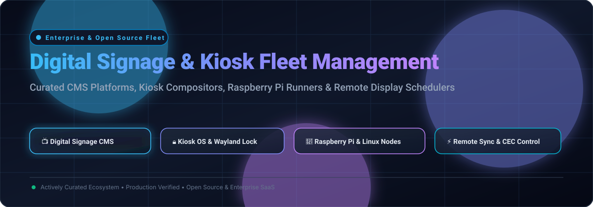

  

# 📺 Awesome Digital Signage & Kiosk Display Management 🚀

  
  
  
  
  
  

  <strong>Curated directory of top-tier Digital Signage CMS platforms, Kiosk Lockdown Compositors, Raspberry Pi Screen Runners, Smart TV Players, and Remote Display Fleet Schedulers.</strong>

  <em>Last updated: November 2026 • Production-grade open-source tools and enterprise SaaS software for digital menu boards, interactive touch kiosks, video walls, and unattended IoT screens.</em>

---

## 📑 Table of Contents

- [📊 Sector Overview & Market Dynamics](#-sector-overview--market-dynamics)
- [🏢 SaaS / Hosted Platforms](#-saas--hosted-platforms)
- [💻 Open-Source GitHub Projects](#-open-source-github-projects)
- [🛠️ Frameworks & Architecture Guide](#️-frameworks--architecture-guide)
- [🤝 How to Contribute](#-how-to-contribute)
- [📈 Star History](#-star-history)
- [☕ Support](#-support)
- [⚠️ Disclaimer & Production Checklist](#️-disclaimer--production-checklist)

---

## 📊 Sector Overview & Market Dynamics

The global digital signage and kiosk display management market is valued at **$29 billion to $34 billion** in 2026, advancing at a **7% to 9% CAGR** fueled by cloud signage transitions, smart retail media networks, workplace KPI screens, and programmatic digital out-of-home (DOOH) networks.

The ecosystem displays a clear architectural bifurcation:
- **Commercial Display Hardware (Moderately Concentrated):** Commercial panels, System-on-Chip (SoC) displays, and smart TVs are moderately concentrated—with industry titans like **Samsung Electronics (Tizen)** and **LG Electronics (webOS Signage)** controlling over 50% of commercial display revenue.
- **Software CMS & Kiosk Management (Highly Fragmented):** Conversely, the Content Management System (CMS), browser lockdown, and remote device management layers are **highly fragmented**. Hundreds of specialized SaaS vendors and open-source projects thrive across distinct niches (retail POS menus, industrial Grafana dashboards, school hall broadcasts, and museum interactives) with no single platform monopolizing the market.

---

## 🏢 SaaS / Hosted Platforms

Below is a breakdown of top commercial cloud digital signage CMS providers, detailing starting subscription costs, free tier/trial limitations, and estimated company scale (sorted descending by revenue/valuation).

| Platform | Description | Starting Price | Free Tier / Trial Limits | Company Scale (Revenue / Valuation) |
| :--- | :--- | :--- | :--- | :--- |
| **[Raydiant](https://raydiant.com)** | 🛍️ Cloud-managed retail and restaurant experience platform uniting digital menu boards, interactive touch kiosks, background audio, and POS integrations. | Starts at **$49.00/screen/month** (Standard plan) | Free trial available upon sales request / demo (no permanent free tier) | **~$100M–$250M valuation** (~$31M–$33M ARR; $50M+ raised) |
| **[ScreenCloud](https://screencloud.com)** | 🏢 Enterprise workplace communication & digital signage suite with 80+ integrations (Canva, Power BI, Slack, Google Workspace, ChromeOS, Windows). | Starts at **$20.00/screen/month** (Core plan, billed annually) | 14-day free trial (up to 3 screens, no credit card required; no permanent free tier) | **~$29.3M annual revenue** (FY2025 UK Companies House filings) |
| **[Scala Digital Signage (STRATACACHE)](https://scala.com)** | 🌐 Heavy-duty enterprise retail and public-venue ecosystem delivering high-concurrency scheduling, sensor/camera triggers, and large-scale video wall governance. | Custom quotes (~**$20.00+/screen/month** per player license equivalent) | Custom sales proof-of-concept / demo only (no permanent free tier) | **~€18.5M annual revenue** (~€8M ARR; acquired for SEK 265M / ~$28M by Vertiseit) |
| **[Yodeck](https://yodeck.com)** | 🥧 Plug-and-play cloud digital signage engine famous for Raspberry Pi players, multi-zone screen widgets, live web dashboards, and remote screen status telemetry. | Starts at **$8.00/screen/month** (Basic plan, billed annually) | Permanent free tier for exactly **1 screen** (reverts to paid for 2+ screens); 30-day trial for up to 5 screens | **~$15M–$25M annual revenue** (Deloitte Fast 500 / Inc. 5000, 350k+ screens) |
| **[OptiSigns](https://optisigns.com)** | ⚡ Versatile cloud digital signage platform supporting Amazon Fire TV, Android, Raspberry Pi, Windows, and Linux with 100+ app widgets and split-screen zoning. | Starts at **$10.00/screen/month** (Standard plan; $9.00/mo billed annually) | Permanent free tier for up to **3 screens** (includes watermark, 25 apps, 1 GB storage); 14-day paid trial | **~$5M–$10M annual revenue** (50k+ active screens worldwide) |
| **[NoviSign](https://novisign.com)** | 🎨 Drag-and-drop digital signage studio offering interactive touch kiosk workflows, social media tickers, emergency broadcasts, and offline media caching. | Starts at **$14.00/screen/month** (Single screen plan, billed annually) | 30-day free trial (full features, no credit card required; no permanent free tier) | **~$6M annual revenue** |
| **[TelemetryTV](https://telemetrytv.com)** | 📈 BI dashboard broadcaster and digital signage platform engineered for real-time KPI screens, operational analytics, and automated ChromeOS/Linux fleets. | Starts at **$8.00/device/month** (TelemetryOS baseline; Core at $18.00/device/mo) | 14-day free trial (access to device logs and proof-of-play; no permanent free tier) | **~$3M–$5M annual revenue** (Bootstrapped SMB scale) |
| **[OnSign TV](https://onsign.tv)** | 📡 Multi-platform cloud signage CMS featuring granular proof-of-play auditing, remote screen capture, conditional GPS/sensor triggers, and Android/Linux players. | Starts at **$19.99/player/month** (Core plan, month-to-month) | 14-day free trial (full feature access, no credit card required; no permanent free tier) | **~$3M annual revenue** (Bootstrapped SMB scale) |
| **[PosterBooking](https://posterbooking.com)** | 🎯 Accessible cloud signage service designed for Fire TV Sticks, Android TVs, and Raspberry Pis with playlist scheduling and white-label reseller controls. | Starts at **$6.49/screen/month** (Business plan for additional screens) | Free plan for up to **10 screens** for first 3 months (watermarked); transitions to paid afterwards | **~$1M–$3M annual revenue** (Bootstrapped UK company) |
| **[Play Digital Signage](https://playsignage.com)** | 🎬 Modern browser-based digital signage editor supporting rich HTML5 animations, Canva embeds, offline media caching, and cross-platform playback. | Starts at **$8.00/screen/month** (Essential plan; $12.00/mo for Pro) | Permanent free tier for **1 screen** (full CMS access); 10-day trial for multi-screen testing | **~$1M–$2.5M annual revenue** (Bootstrapped SMB scale) |

---

## 💻 Open-Source GitHub Projects

Self-hosted digital signage CMS solutions, Wayland kiosk compositors, locked-down browser runners, and remote display utilities.

*Sorted descending by GitHub stars count:*

- **[RustDesk](https://github.com/rustdesk/rustdesk)**   
  ⚡ Fast, open-source self-hosted remote desktop software written in Rust. The gold standard for securely remoting into unattended kiosk computers, digital signage players, and edge terminals behind firewalls without commercial subscriptions.

- **[Homepage](https://github.com/gethomepage/homepage)**   
  📊 Highly customizable, lightweight, and modern service dashboard with instant Docker and API integrations, frequently deployed as an always-on status wall display in NOCs and IT office kiosks.

- **[Dashy](https://github.com/lissy93/dashy)**   
  🚀 Ultimate open-source dashboard application equipped with 50+ built-in widgets, real-time status checking, multiple themes, and a visual UI editor tailored for wall-mounted information kiosks.

- **[MagicMirror²](https://github.com/MagicMirrorOrg/MagicMirror)**   
  🪞 Modular open-source smart mirror and information display platform with an ecosystem of hundreds of community plugins for calendars, weather forecast animations, RSS news, transit schedules, and IoT home controls.

- **[FullPageOS](https://github.com/guysoft/FullPageOS)**   
  🥧 Purpose-built Raspberry Pi OS image that boots straight into a fullscreen, hardware-accelerated Chromium kiosk browser displaying any target URL—perfect for Grafana monitors and web-based signage.

- **[Anthias — formerly Screenly OSE](https://github.com/Screenly/Anthias)**   
  📺 Most popular dedicated open-source Raspberry Pi digital signage software. Features an intuitive web UI and REST API to schedule 1080p/4K video loops, images, and live web assets.

- **[jxlarrea/kiosk-satellite](https://github.com/jxlarrea/kiosk-satellite)**   
  🛰️ Dedicated open-source kiosk display manager and tablet lockdown runner built from the ground up for Home Assistant, wall dashboards, and distributed screen nodes.

- **[Cage](https://github.com/cage-kiosk/cage)**   
  🔒 Minimalist, unbreakable Wayland kiosk compositor for Linux that runs a single maximized graphical application or browser with zero desktop chrome or window-switching escape vectors.

- **[Immich Kiosk](https://github.com/damongolding/immich-kiosk)**   
  🖼️ Lightweight, highly configurable slideshow application for displaying media assets from self-hosted Immich instances on browser screens, tablets, and smart picture frames.

- **[TRMNL Firmware](https://github.com/usetrmnl/trmnl-firmware)**   
  📟 Open-source firmware for ultra-low-power E-Ink and ePaper display terminals, rendering battery-efficient desk, shelf, and wall signage updated via webhook plugins.

- **[libCEC](https://github.com/Pulse-Eight/libcec)**   
  🔌 Industry-standard HDMI-CEC communication library and command-line utilities (`cec-client`) enabling automated cron scripts to power commercial TVs and monitors on and off over HDMI.

- **[FreeKiosk](https://github.com/RushB-fr/freekiosk)**   
  📱 Open-source Android kiosk mode and tablet lockdown app for digital signage, interactive dashboards, and POS devices; free self-hosted alternative to Fully Kiosk Browser.

- **[piSignage](https://github.com/colloqi/piSignage)**   
  🥧 Open-source Raspberry Pi digital signage player and Node.js management server supporting synchronized multi-screen playback, offline caching, and remote TV CEC power control.

- **[Xibo](https://github.com/xibosignage/xibo)**   
  🏢 Enterprise-grade open-source Digital Signage CMS featuring multi-zone layout designers, campaign scheduling, proof-of-play analytics, webhooks, and Docker/Linux/Windows/Android players.

- **[LibreSignage](https://github.com/eerotal/LibreSignage)**   
  📝 Free, lightweight, self-hosted digital signage solution featuring an in-browser slide editor, collaborative multi-user access control, timeline scheduling, and REST APIs.

- **[Concerto](https://github.com/concerto/concerto)**   
  🎓 Classic open-source web-based digital signage platform built in Ruby on Rails, widely adopted by universities and campuses for moderated multi-screen content feeds.

- **[ScreenLite](https://github.com/screenlite/screenlite)**   
  💡 Lightweight open-source digital signage management platform focused on rapid deployment, low resource consumption, and intuitive multi-display control.

- **[WebView Kiosk](https://github.com/nktnet1/webview-kiosk)**   
  📱 Minimalist open-source Android app that turns any phone or tablet into a locked-down fullscreen web page kiosk with screen-wake and persistent URL caching.

- **[ScreenTinker](https://github.com/screentinker/screentinker)**   
  🛠️ Open-source signage management application allowing administrators to broadcast, orchestrate, and control rich multimedia on remote displays and kiosks from any web browser.

- **[Buildroot-WebKit](https://github.com/TOLDOTECHNIK/buildroot-webkit)**   
  ⚡ High-speed Buildroot WebKit fullscreen browser image for Raspberry Pi Zero/W and 3B, engineered for ultra-fast boot times and minimal memory footprint in HTML5 kiosks and video loops.

- **[dividuum/info-beamer](https://github.com/dividuum/info-beamer)**   
  ✨ High-performance multimedia presentation engine for Lua and OpenGL, capable of hardware-accelerated video walls, seamless shader transitions, and live data overlays on Raspberry Pi.

- **[WassGha Digital Signage](https://github.com/wassgha/digital-signage)**   
  📺 Simple self-hosted digital signage software designed to turn screens and smart displays into beautiful multimedia presentations with zero configuration overhead.

- **[Ubuntu Frame](https://github.com/canonical/ubuntu-frame)**   
  🐧 Canonical's open-source Mir-based fullscreen display server engineered for reliable, secure, and auto-recovering embedded Linux kiosks and IoT digital signage screens.

- **[Porteus Kiosk](https://porteus-kiosk.org)**  
  🛡️ Read-only, locked-down Gentoo-based Linux OS designed specifically for public web terminals, library computers, and unattended digital signage displays.

---

## 🛠️ Frameworks & Architecture Guide

For sysadmins and engineers architecting custom on-premise digital signage systems:
1. **CMS & Asset Management:** Deploy **Xibo** or **Anthias** for timed playlist scheduling, multi-zone screen layouts, and media asset caching.
2. **Kiosk OS & Compositor:** Pair **FullPageOS** or Alpine/Debian Linux with **Cage** (Wayland) to lock down the screen, preventing end users from accessing desktop environments or taskbars.
3. **Hardware Display Automation:** Use **libCEC** (`cec-client`) via cron scripts to automatically power commercial TVs on before business hours and off after closing, preventing OLED/LCD panel burn-in.
4. **Fleet Telemetry & Remote Control:** Deploy **RustDesk** or **jxlarrea/kiosk-satellite** for low-latency remote troubleshooting, screen monitoring, and remote URL push across distributed screen clusters.

---

## 🤝 How to Contribute

Contributions to expand and update this ecosystem guide are warmly encouraged!

1. 🍴 Fork the repository.
2. 📝 Add or update tools in `README.md` following the existing format.
3. 🔗 Verify that all project links, pricing points, and star badges are accurate.
4. 🚀 Submit a pull request with a concise description of the addition.

---

## 📈 Star History

---

## ☕ Support

If you find this curated list helpful for your deployments or research, consider supporting the maintenance of this repository:

- ⭐ **Star this repository** to help others in the community discover it.
- 🍴 **Fork & Share** it with your engineering team, sysadmin colleagues, or online communities.
- ☕ **Sponsor on GitHub Sponsors**: Help fund ongoing maintenance and feature guides on [ishandutta2007's Sponsor Dashboard](https://github.com/sponsors/ishandutta2007) — featuring sponsor tiers for profile recognition, README shoutouts, and prioritized issue assistance!

  

---

## ⚠️ Disclaimer & Production Checklist

- 📌 *Disclaimer*: This repository is a community-curated directory for informational and educational purposes. Inclusion does not constitute an endorsement.
- 🔒 **Security Hardening**: For all unattended public kiosk installations (`FullPageOS`, `FreeKiosk`, `Cage`), ensure you disable virtual terminal switching (`Ctrl+Alt+F1–F7`), disable USB storage auto-mounting, hide browser address/navigation bars, and segregate player devices onto dedicated IoT VLANs.
- 💾 **Flash Memory Protection**: Use industrial high-endurance microSD cards or configure read-only overlay filesystems (`overlayfs`) on Raspberry Pi and Linux signage boards to safeguard against storage corruption caused by unexpected power cuts.

  Built with ❤️ for IT sysadmins, retail operators, museum technologists, and the open-source community.

